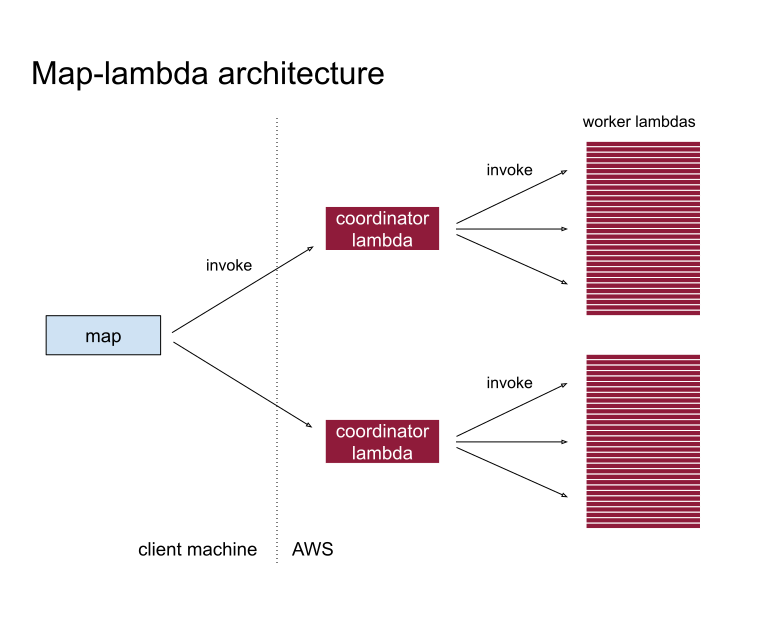

# Map-lambda

<!-- --8<-- [start:intro] -->
A highly-scalable parallel Python map function running on Rust AWS lambdas.

The framework imposes very little overhead for latency:

> **1000 workers launch, run and return outputs in ~1s cold and ~0.5s warm** (for a [no-op worker](https://github.com/tomwhite/map-lambda/blob/main/benchmarks/echo_latency.py))

While also being ideal for data-intensive applications:

> **a four stage rechunk of the original ERA5 dataset (1 variable) 1.4TB takes ~140s and costs ~$2.45; 3.7x faster than Cubed** (from [rechunk-lambda-benchmarks](https://github.com/tomwhite/rechunk-lambda-benchmarks))

Note: This library is alpha-quality. The API and its behaviour may change in the future.

## How it works

There are two levels of lambdas: a small number of **dispatcher** lambdas fan out to a large number of **worker** lambdas that run a pre-deployed compute function. The map **inputs** are split into **partitions**, and each partition is handled by a dispatcher.

Having dispatchers run in AWS removes the need for the client to manage a large number of network connections to the workers. The client still gets progress updates since they are sent periodically by the dispatchers over a small number of persistent HTTP connections.

There is no persistent state for coordination - everything flows through the lambda functions. As a result the system can scale to a thousand workers in ~1s.

<!-- --8<-- [end:intro] -->



<!-- --8<-- [start:design] -->
## Design

- **AWS only**. The implementation is deliberately targetted only at AWS Lambda and not other serverless function platforms, which avoids lowest-common denominator effects, and makes it easy to build on existing projects like [Cargo Lambda](https://www.cargo-lambda.info/). Knowledge of the limits in AWS Lambda (like number of concurrent lambdas, scaling rate, etc) can be built directly into the implementation.
- **Rust on the backend, Python on the frontend**. Taking advantage of Rust's high-performance and small binary size for AWS Lambdas means that cold start time is low (tens of milliseconds), while offering a Python API to make it easy to integrate in data processing applications. The client is Rust too; the Python API is a thin PyO3 binding over it.
- **Execution not storage**. Most map-lambda applications will process data on S3, however this is not a part of the library so it is up to applications to make sure the lambda is deployed in the same AWS region, manage S3 request rates, etc. 

<!-- --8<-- [end:design] -->

## Using it

<!-- --8<-- [start:using] -->
The `map_lambda` Python module provides a small API for running map functions. The following shows a simple example map for squaring integers.

```python
import map_lambda

async for index, output in map_lambda.map_unordered("square", [1, 2, 3], input_key="input"):
    print(index, output)
```

`square` is the name of an AWS Lambda function, implemented in Rust using Cargo Lambda, which receives a request struct with a field containing the input value, and returns a response struct with the output:

```rust
use lambda_runtime::{Error, LambdaEvent};
use serde::{Deserialize, Serialize};

#[derive(Deserialize)]
pub(crate) struct Request {
    /// The input value being processed.
    input: i64,
}

#[derive(Serialize)]
pub(crate) struct Response {
    /// The output value of the function.
    output: i64,
}

pub(crate) async fn function_handler(event: LambdaEvent<Request>) -> Result<Response, Error> {
    let input = event.payload.input;
    let output = input * input;
    Ok(Response { output })
}
```

The worker lambda must be **idempotent** since inputs may be rerun in some circumstances (see "Failures and retries" below).

**Extra arguments** may be passed to each worker invocation via the `constant_args` Python argument. These are sent to the Rust `Request`, which must have the corresponding structure.

Inputs and outputs are sent as JSON, so they must be JSON-serialisable (e.g. Python `pickle` is *not* used). Inputs and outputs are used to coordinate a computation, so they should be small (a few KB) - large data values may be processed by providing a reference to them; they should not be passed as inputs or outputs.

`map_unordered` yields a **pair** per output: the position in `inputs` of the invocation that produced it, and a **dict** of the fields of the Rust `Response` object. Outputs arrive **as the workers finish them**, in no particular order, so `index` is what ties an output to its input. For the example above the output is some permutation of:

```
0 {'output': 1}
1 {'output': 4}
2 {'output': 9}
```

There is also a `for_each` function, which takes exactly the same arguments as `map_unordered` but doesn't return any values. The return type of the Rust `function_handler` in this case should be `Result<(), Error>` to indicate an empty response.

Functions deployed for a **project** have its name as a prefix, so two projects can each have a worker called `copy` without clashing. If memory is specified then it forms part of the function name too, so a call to `map_unordered("square", ..., project="math", memory=1024)` calls the lambda function `math-square-1024`.

Map-lambda provides **diagnostics** in the form of progress updates as the `map_unordered` (or `for_each`) call runs, dispatcher and worker invocation stats at the end of the run, and way to visualise the invocations over time. See the API doc and/or examples for details.

## Failures and retries

A worker invocation is retried only if the request to Lambda fails, rather than the worker itself - for example if it is throttled, Lambda returns a service error, or the connection drops. After a dropped connection or a service error the worker may still have run, so retrying is permitted only because the function is idempotent. An error that another attempt can't change, like a missing permission or function, is not retried, so the call fails straight away.

The number of retries is set by the `retries` argument to the call, and defaults to 2. If the worker returns an `Error` it is *not* retried; it is assumed that the worker function will retry I/O errors itself.

The call fails with a `RuntimeError` in any of the following cases:
- if the inputs cannot be dispatched,
- if any invocation fails (a worker error, or a request to Lambda that still fails after retrying),
- if there is a stream error,
- if the stream does not end with a summary frame,
- or if the dispatcher fails.

Once an invocation has failed, its dispatcher starts no more. Those already running finish, and other dispatchers run the rest of their partitions.

## Out of scope

What is not guaranteed by the framework.

- **Dispatcher retries**. There is no mechanism for retrying dispatchers. If a dispatcher fails then the call will fail and will need to be re-run by the client.
- **Cancellation**. There is no cancellation mechanism, so once lambdas have started they will continue running in AWS. This can happen if the client fails or any of the connections to the dispatchers fail. A dispatcher does not find out that the client has gone, so stopping a call early still runs, and bills for, the rest of each partition.
- **Payload validation**. It is up to the user to ensure that the deployed lambda function matches the Python frontend. A mismatch will be treated as a deserialisation error in the worker for each invocation.

<!-- --8<-- [end:using] -->

## Deployment

<!-- --8<-- [start:deployment] -->
An application deploys its workers and dispatcher in one CloudFormation stack, named after the project, holding the functions, their IAM roles and their log groups.

The examples below deploy map-lambda's own project, which is the dispatcher and `echo` - a simple example function that returns its input.

Deploying needs AWS credentials and a region, which are found in the same way as the `aws` CLI. `--region` overrides the region.

### Deploying from a release

This needs only [uv](https://docs.astral.sh/uv/), not Rust: the Python wheels and the lambda zips both come from a [GitHub release](https://github.com/tomwhite/map-lambda/releases).

```shell
RELEASE=https://github.com/tomwhite/map-lambda/releases/expanded_assets/v0.1.0.dev1
uvx --python 3.12 --from 'map-lambda[deploy]' --find-links $RELEASE map-lambda-deploy deploy
```

This lists everything it will change, then asks for confirmation before creating the CloudFormation stack. `--python 3.12` is needed where the default Python is older, as it is in CloudShell.

To check it works, run `echo` through the deployed dispatcher:

```shell
uv run --python 3.12 --no-project --with map-lambda --find-links $RELEASE python -c '
import asyncio, map_lambda

async def main():
    async for index, output in map_lambda.map_unordered("echo", [1, 2, 3], input_key="i", project="map-lambda"):
        print(index, output)

asyncio.run(main())
'
```

The same commands work in [AWS CloudShell](https://aws.amazon.com/cloudshell/), which has credentials and a region already set, once uv is installed:

```shell
curl -LsSf https://astral.sh/uv/install.sh | sh
source $HOME/.local/bin/env
export UV_CACHE_DIR=/tmp/uv-cache   # CloudShell's home directory is limited to 1 GB
```

### Seeing what is deployed

```shell
uvx --python 3.12 --from 'map-lambda[deploy]' --find-links $RELEASE map-lambda-deploy list
```

### Deleting it

```shell
uvx --python 3.12 --from 'map-lambda[deploy]' --find-links $RELEASE map-lambda-deploy delete
```

### Deploying from source

From a checkout, building the zips needs Rust, [Zig](https://ziglang.org/) and [cargo lambda](https://www.cargo-lambda.info/):

```shell
uv run python -m map_lambda.deploy deploy --from-source
```

A plain `deploy` from a checkout refuses to use a release's zips, as they needn't match the checked-out code. `list` and `delete` work from a checkout as `uv run python -m map_lambda.deploy list` and `uv run python -m map_lambda.deploy delete`.

<!-- --8<-- [end:deployment] -->

## Building and testing map-lambda

<!-- --8<-- [start:development] -->
The Python package is built with [maturin](https://www.maturin.rs/), so a Rust toolchain is needed to install it from source. `uv sync` builds the extension, and `uv run` rebuilds it whenever the Rust under `rust/` changes.

`uv run pytest` runs the Python tests. The `lambda_integration` ones are deselected by default; run them with `uv run pytest -m lambda_integration` once the local server below is running.

In the `rust/` directory:

`cargo lambda build --package echo --package map-lambda-dispatcher`

`cargo test` runs the Rust unit tests for every crate in the workspace.

`cargo lambda watch` runs a local server at `http://localhost:9000` serving *every* lambda crate at once, routed by function name in the URL, rebuilding on file changes. It serves each function under its binary's name, so a session using it never prefixes names with a project.

To invoke a worker manually, use `cargo lambda` or `curl` directly:

```shell
cargo lambda invoke echo \
  --data-ascii '{"i":1,"default_sleep":0.0}'

curl -X POST \
  http://localhost:9000/2015-03-31/functions/echo/invocations \
  -d '{"i":1,"default_sleep":0.0}'
```

### Releasing

Set the version in `pyproject.toml` (`0.1.0.devN` for now), run `uv lock`, and push a tag of the same version prefixed with `v`, such as `v0.1.0.dev1`. The release workflow builds the dispatcher and echo zips with `python -m map_lambda.deploy build`, and wheels for Linux x86-64 and arm64 and macOS arm64, with the zips' checksums in each wheel (in `map_lambda/deploy/echo.sha256`), then attaches them all to a GitHub release, marked as a pre-release for a dev version. Then update `RELEASE` under Deployment to the new tag.

<!-- --8<-- [end:development] -->

## AI usage

Code and tests were written with AI assistance from Claude. Most of the documentation was written by hand.
