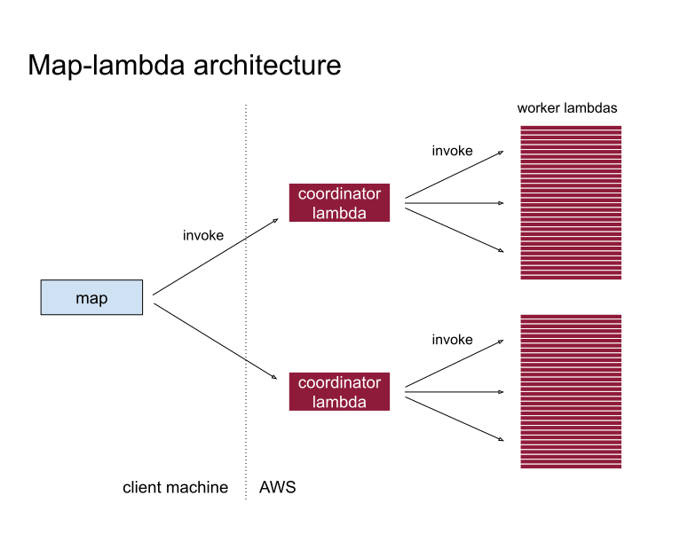

# Announcing map-lambda and a rechunk benchmark

*Map-lambda is a new primitive operation for building data-intensive processing tools, like rechunking or resampling, that have a Python interface and a Rust backend running on AWS Lambda. A rechunk benchmark for 1.4TB of ERA5-shaped data showed a 3.7x performance increase over a similar benchmark from last year using Cubed on Lithops.*

<!-- more -->

In recent years the trend for building data-intensive processing tools using Rust has grown enormously. In the Zarr ecosystem alone we have seen projects like [obstore](https://github.com/developmentseed/obstore), [Icechunk](https://icechunk.io/en/latest/) and [`zarrs`](https://zarrs.dev/) become established due in part to their superior performance characteristics from their use of Rust, while still being accessible from Python via PyO3 bindings.

### Introducing map-lambda

In this post, I'd like to present a new framework called **map-lambda**, which is a simple (less than 2000 LOC) map primitive that dispatches to AWS Lambdas written in Rust on the backend. Map-lambda uses both Python and Rust just like the examples mentioned above - Python on the frontend to make the API approachable to Python users, Rust on the backend for performance.

Think of map-lambda as a building block for building data services. It's not an out-of-the-box solution for running queries, for example, but more like an execution framework that other tools can use for providing compute.

Where it shines is in handling bursty workloads that need low latency dispatching, and high throughput data processing. In initial tests, the framework can run 1000 workers from cold and retrieve their results in around one second - these workers deliberately do no processing, so we can easily measure the latency overhead. And in terms of throughput, it can crunch multi-terabyte datasets in an impressive time as we see below.

### A toy example

First, let's briefly look at the API that map-lambda provides to get a better feel for what it does. This is a toy example that doesn't do any data processing - it just does a simple computation - but you can see how the parts work and where real processing would slot in.

In Python we call `map_unordered` with a function name (`square`) and a list of input values.

```python
import map_lambda

async for index, answer in map_lambda.map_unordered("square", [1, 2, 3], input_key="input"):
    print(index, answer)
```

`square` is the name of an AWS Lambda function, implemented in Rust using [Cargo Lambda](https://www.cargo-lambda.info/), which receives a request struct with a field containing the input value, and returns a response struct with the output:

```rust
use lambda_runtime::{Error, LambdaEvent};
use serde::{Deserialize, Serialize};

#[derive(Deserialize)]
pub(crate) struct Request {
    /// The input value being processed.
    input: i64,
}

#[derive(Serialize)]
pub(crate) struct Response {
    /// The output value of the function.
    output: i64,
}

pub(crate) async fn function_handler(event: LambdaEvent<Request>) -> Result<Response, Error> {
    // A realistic example would do data processing or compute work here
    let input = event.payload.input;
    let output = input * input;
    Ok(Response { output })
}
```

The map-lambda framework is responsible for dispatching the Python inputs to the deployed AWS Lambdas, and returning the results. These come back as workers finish, so `index` can be used to tie an output to its input if order matters. The example here will print something like the following, in no particular order:

```
0 {'output': 1}
1 {'output': 4}
2 {'output': 9}
```

### Implementing rechunk using map-lambda

The original impetus for writing map-lambda and the motivating use case was *rechunking* - I wondered what a serverless rechunk in the cloud would look like using AWS Lambda directly, and with `zarrs` on the backend.

Rechunking is where a Zarr array  is rewritten with exactly the same data, but with a different chunk structure. It is a very data intensive operation since the entire dataset is copied (possibly in multiple stages, depending on how radically the target chunk structure differs).

A map operation is exactly what is needed here, since the copies can all be done in parallel as they don't overlap, and the map values are chunk coordinates identifying the copy for each task to perform. The key idea is that the map is used only as a convenient *coordination* mechanism: the Zarr data does *not* flow through the map.

To compare map-lambda with previous rechunking benchmarks, I used the algorithm from the rechunker project to chose the copy chunks (which runs in Python), and a Rust lambda for copying between two Zarr stores (using the `zarrs` Rust crate).

The code, which is in [rechunk-lambda-benchmarks](https://github.com/tomwhite/rechunk-lambda-benchmarks), also has a utility command to create incompressible test data which has deterministically hashed integer values that are independent of chunking - and a command to validate the same data after rechunking. By using incompressible data we exercise the copy pipeline's resource usage, and using a deterministic hash allows us to verify every element of the target array is the same as the source in a low-cost way.

The workload for comparison was an ERA5-shaped variable of around 1.4TB, where we wanted to convert from the time-chunked version to one that is space-chunked. With the map-lambda framework, the rechunk ran four stages in 142.68s and cost approximately $2.45. This is **3.7 times faster** than the same workload running on Cubed and Lithops from [last year](https://github.com/cubed-dev/cubed/issues/650#issuecomment-2729027467).


### Comparison with Lithops

The new benchmark ran significantly faster due to a series of smaller improvements. These can be divided between the rechunking itself, and the map-lambda framework.

The rechunking itself benefitted from the following improvements:

- **Lower memory usage.** `zarrs` has a lower memory overhead than the Zarr-Python/fsspec stack used previously, which meant fewer stages could be used in the rechunk.
- **Faster I/O.** `zarrs` is just [more performant](https://github.com/zarrs/zarr_benchmarks#standalone) in terms of raw I/O than Zarr-Python/fsspec.
- **Sharding reduces IOPs.** Another optimization which helped was using sharding in intermediate Zarr stores to reduce the number of S3 requests.

There are several differences between map-lambda and Lithops, but the main ones that helped in this case were:

- **Significantly smaller image size.** The Rust images used by map-lambda are a lot smaller than the Python images used in Lithops. For example, the one used in the rechunk was around 4MB compared to 400MB for the one Cubed used with Lithops.
- **No object store for coordination.** Lithops sends the pickled function, inputs and outputs through object storage, which adds latency to the client and to worker functions. Map-lambda does not support dynamic functions at all, and serialises the inputs and outputs directly over the HTTP calls to the lambda function.
- **Coordination in AWS.** A Lithops client is very chatty, since it launches all of the workers from the client, and polls object storage for new results. Map-lambda, on the other hand, uses *dispatcher* lambdas that are deployed within AWS to manage the fan out with the thousands of worker lambdas, and the client only has to manage a handful of persistent HTTP connections with the dispatchers. This architecture is illustrated in the following diagram:



### Other use cases

Rechunking serves as a challenging use case for map-lambda, since it is a very I/O intensive workload. However, there are many other data processing applications that could run on map-lambda.

Some ideas include file conversion to Zarr, resampling, and blockwise operations - anything where the operation is known ahead of time and can be implemented in Rust.

If you have a possible use case you'd like to discuss, please reach out or [start a discussion](https://github.com/tomwhite/map-lambda/discussions) on GitHub.

*Update (27 October 2026): changed 'coordinator' to 'dispatcher' following change in the code.*